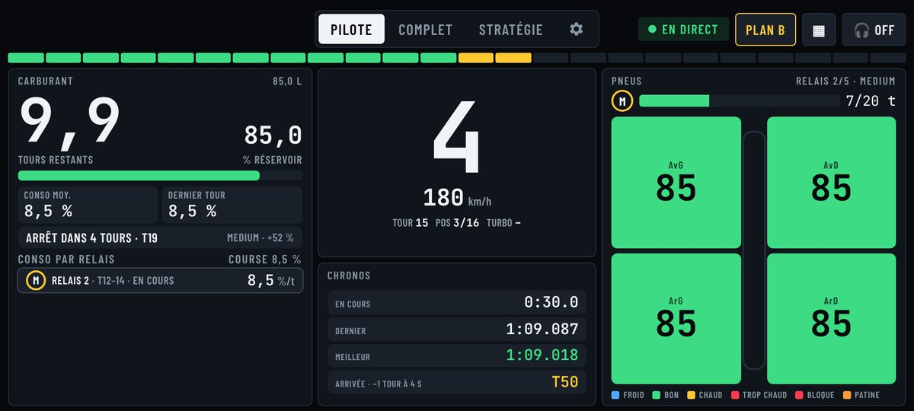
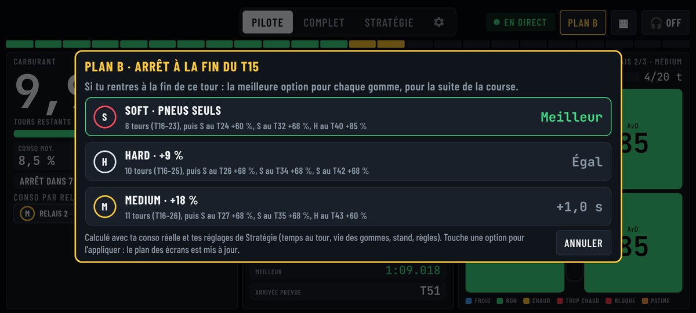
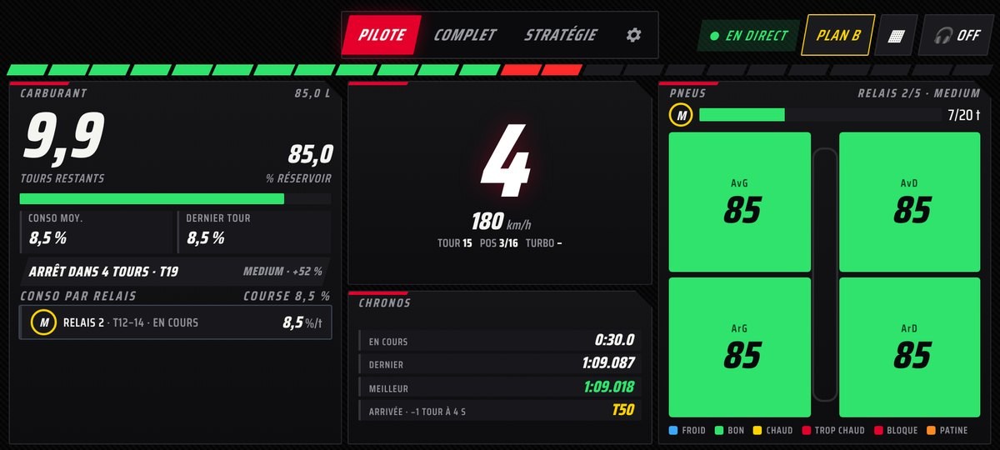
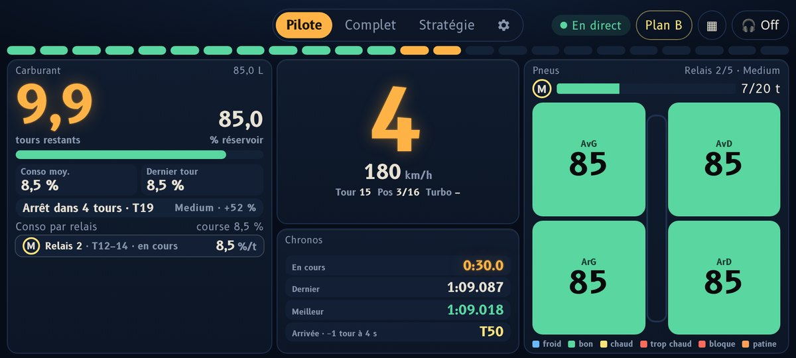

# Strat GT7 · GT7 Race Engineer V2

Un ingénieur de course pour les courses d'endurance de Gran Turismo 7. L'appli lit la télémétrie de ta PS5 en direct et te dit quand rentrer, quelle gomme monter, combien d'essence remettre, et quoi faire si la course ne se passe pas comme prévu. La stratégie se prépare avant, l'écran Pilote te guide pendant.

**Installer sur Android (sans PC) :** ouvre ce lien sur ton téléphone et installe le fichier : https://github.com/RazHalpox/strat-gt7/releases/download/android/gt7-race-engineer.apk
L'appli se met ensuite à jour toute seule. Guide complet : [race-engineer/LISEZMOI.md](race-engineer/LISEZMOI.md).

---

## Ce que fait l'appli

| En course | Ce que tu vois ou entends |
| --- | --- |
| Carburant | Tours restants, niveau en % du réservoir, conso moyenne et du dernier tour (1 à 3 décimales), conso de chaque relais |
| Arrêts | Bandeau « Arrêt dans 2 tours · T22 » avec la gomme et l'essence à remettre, recalculée en direct ; BOX BOX au bon tour, en gros au-dessus du rapport |
| Essence courte | La conso à viser pour tenir jusqu'à l'arrêt : « Vise 8,3 %/t (−0,3) jusqu'au T22 », ou « rentre plus tôt » si c'est impossible |
| Arrivée | En course à la durée, le tour d'arrivée prévu d'après ton vrai rythme, et l'alerte quand un tour de plus ou de moins se joue à quelques secondes |
| Plan B | Accident, crevaison : la fin de course est recalculée depuis ta situation réelle. Il s'ouvre tout seul quand tu entres aux stands hors stratégie, et l'ingénieur annonce le meilleur choix |
| Pneus | Températures en couleur, blocage au freinage et patinage, usure du relais |
| Voix | Un ingénieur en français : temps au tour, carburant, arrêts, conso à viser, arrivée |

Après la course, l'appli a tout mesuré : ton rythme et l'usure de chaque gomme, le temps perdu à chaque arrêt, la vitesse de ravitaillement. Un geste dans **Stratégie › Paramètres › Mesuré en course** et ta prochaine stratégie part de tes vrais chiffres. Chaque course est gardée dans le **Carnet** (relais, arrêts, tours, export CSV), et la télémétrie est enregistrée, sur le téléphone comme sur l'iPad qui affiche les écrans, pour être **rejouée** ou exportée.

## Les écrans

| Écran | À quoi il sert | Quand |
| --- | --- | --- |
| Pilote | L'essentiel en très gros, fenêtres déplaçables (bouton ▦) | Pendant la course |
| Complet | Tout le détail, la radio de l'ingénieur, l'historique, l'envoi de ta conso vers la stratégie | En essais, ou en course pour plus d'infos |
| Stratégie | Le meilleur plan d'arrêts, tes mesures en course, le carnet de courses | Avant et après la course |
| ⚙ Réglages | Thème, alertes, Plan B automatique, voix, seuils carburant et pneus | Une fois, puis quand tu veux |

## Trois thèmes

À choisir dans ⚙ Réglages › Apparence. Les polices sont intégrées : même rendu avec ou sans internet.

| Racing GT3 | Nuit d'endurance |
| --- | --- |
|  |  |
| Carbone, rouge course, chiffres façon écran de volant | Habitacle sombre et cadrans ambre qui n'éblouissent pas quand tu roules dans le noir (police B612, dessinée pour les cockpits) |

---

## Installer

**Android, sans PC (conseillé).** Installe l'APK avec le lien ci-dessus, tape l'adresse IP de la PS5 (Paramètres › Réseau › Afficher l'état de la connexion) et touche **Démarrer**. Téléphone et PS5 doivent être sur le même Wi-Fi.

**iPhone ou iPad.** Ils ne peuvent pas recevoir la télémétrie eux-mêmes. Pendant que l'appli Android (ou le PC) tourne, ouvre dans Safari l'adresse affichée sur son accueil, par exemple `http://192.168.1.30:8777/pilote.html`.

**PC Windows.** Bouton vert **Code › Download ZIP** sur cette page, garde le dossier `race-engineer`, installe Python 3 puis double-clic sur `lancer.bat`. `lancer-demo.bat` fait tourner une course simulée sans PS5, `rejouer-course.bat` rejoue la dernière course enregistrée. Pas à pas : [race-engineer/LISEZMOI.md](race-engineer/LISEZMOI.md).

---

## Le calculateur de stratégie seul (web)

Sans télémétrie, le calculateur fonctionne aussi seul dans le navigateur : **https://razhalpox.github.io/strat-gt7/**
Sur iPhone : ouvre-le dans Safari, **Partager › Sur l'écran d'accueil**. Sur Android : Chrome, **⋮ › Ajouter à l'écran d'accueil**. Il marche ensuite hors connexion.

1. **Paramètres › Réglages du salon** : course à la durée ou aux tours, refuel rate (L/s), réservoir et carburant au départ.
2. **Consommation** : note ton carburant au début et à la fin de 3 à 5 tours lancés (100 L de réservoir : 1 % de jauge = 1 L).
3. **Gommes** : pour Soft, Medium et Hard, ton temps au tour moyen sur un relais et la vie de la gomme en tours. Coche les gommes obligatoires.
4. **Stand** : le temps perdu pour un arrêt pneus seuls (tour avec arrêt moins tour normal), et le calcul des arrêts avec essence (pneus + litres ÷ refuel rate, ou temps fixes).
5. **Règles** : nombre de gommes différentes imposées. L'appli en déduit le nombre d'arrêts minimum.
6. **Stratégie** : chiffres clés, frise des relais, comparaison des stratégies par nombre d'arrêts, plan de relais avec les litres à remettre, stratégies sauvegardées, tours possibles avec une quantité donnée. En mode **Je choisis**, tu choisis la gomme de chaque relais et, si tu veux, son nombre de tours (case « t » ; vide = réparti automatiquement). Un relais plus long qu'un plein peut être validé quand même en économie d'essence : l'appli donne la conso à viser.

Les valeurs pré-remplies sont des exemples à remplacer par tes mesures. Le calcul cherche le temps total le plus court ; il ne tient pas compte du trafic ni de la météo.

---

## À savoir

- La télémétrie de GT7 ne concerne que ta voiture : ni les pneus ni la position des autres pilotes ne sont disponibles.
- Un seul programme à la fois peut recevoir la télémétrie (ferme SimHub ou le relais PC si l'appli Android ne reçoit rien).
- La stratégie, le Plan B et le carnet sont partagés entre tous les écrans branchés sur le même téléphone ou PC (téléphone, iPad…). Les réglages (thème, voix), la disposition et les enregistrements restent sur chaque appareil.
- Projet indépendant, sans lien avec Polyphony Digital ni Sony Interactive Entertainment. Polices sous licence SIL Open Font License (Barlow Condensed, IBM Plex Sans, JetBrains Mono, Saira Condensed, B612), licences dans `race-engineer/web/fonts`.
